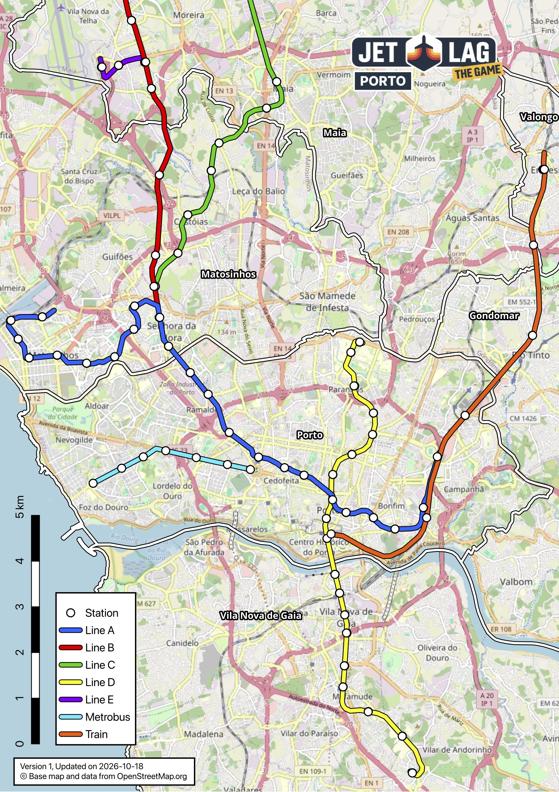

## Jet Lag: Hide and Seek - Porto, Portugal

This is a map of the cities and public transport lines of the Porto Metropolitan Area, for use in playing Hide and Seek. It has also been uploaded to https://maps.jetlag.games/map/Porto-Portugal-1yrqf2t8sei9s9n where you can find maps for other cities and countries.

### Game design

With an Andante that has all zones, you are able to move anywhere and use all methods of transport.

Size is A4 for ease of printing.

As a rule, only stations with frequency of less than 15 minutes were selected. This means that only the following is allowed:

- Metro Line A
- Metro Line B, until Pedras Rubras
- Metro Line C, until Fórum Maia
- Metro Line D
- Metro Line E
- Metrobus, which although disconnected from the Metro, is still very viable
- The only Train segment with good frequency (served by 3 different lines)

The following stations were NOT, and I would recommend that you do NOT include them in your game:

- Metro Line F, as the frequency is not on par with the rest of the Metro lines
- Eléctrico lines, as the frequency is terrible
- Any Train line that is not the previously mentioned segment

### Modifying map

The map was created using QGIS, open `jet-lag.qgz` in it and it should all load fine.

When the new Metro lines open (Rubi and Pink), the workflow to add them to the map is as follows:

1. With the QuickOSM plugin, make a query for `key=railway` `value=stop`
  - This will get all the stops, which might be more than 1 per station, manually delete the extra ones.
  - If you use `value=station` it is guaranteed to be just 1, but some stations dont have a "point" node for some reason, so it would require manual adjustment as well.
    
2. Create a new GeoPackage layer with type LineString and trace over the new line, assigning it a color
  - So why not use data from OpenStreetMaps? I find it incomplete and impossible to filter. The current lines dont have names nor metadata that can distinguish them, so its easier to manually trace them.

3. Once you are happy with how it looks, go to `Project -> Layouts -> print`, update the legend with the new line, and export it however you desire.

### Data Attribution and License

Base map and data from © OpenStreetMap.

The data is available under the Open Database License (ODbL) 1.0.
